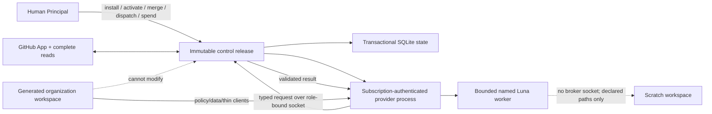

# Architecture

## Trust zones

The Human Principal is the only governance principal. The Portfolio Orchestrator is an
external coordination identity, not a project control-plane administrator. The installed
controller is trusted code. GitHub and provider responses are untrusted external input that
must be complete and validated. Generated repositories, prompts, issue bodies, PR bodies,
logs, artifacts, worker output, and all project-local configuration are untrusted.

## Request path

Each wake creates a server-side session containing organization, role, repositories, policy
digest, expiry, budget reservation, and worker counters. The agent receives only a Unix
socket path. A length-prefixed JSON protocol accepts a closed operation vocabulary. The
broker rejects caller identity, credentials, URLs, methods, raw command arguments, provider
choices, and model choices. Authorization uses fresh facts and journals the decision before
the fixed backend executes it.

Issue/Project and PR requests use `pm-gh.sh`; remote branch content uses
`git-push-branch.sh`. The latter sends a bounded content manifest. The controller validates
paths, modes, hashes, protected surfaces, branch ownership, base freshness, and then uses the
Git database API with an expected-head check and a non-force ref update. Agents never perform
a network Git push; GitHub does not provide an atomic compare-and-swap for this entire sequence,
so branch protection and conflict handling remain required.

## Delivery and reconciliation

Every event source owns its checkpoint. A poll snapshot stages observations as pages arrive;
staged events are not routeable. Only complete pagination atomically publishes those events
and advances the watermark. Comment versions include `updated_at`; workflow versions include
run attempt, status, conclusion, and update time. Routing creates durable event-role targets
and idempotent deliveries. Leases make delivery at least once; success, retry, budget hold,
uncertainty, and dead letter are explicit states.

Governance observations are `TRUE`, `FALSE`, or `UNKNOWN`. Any incomplete input becomes
`UNKNOWN`, and planning returns no mutation. Creates, moves, and closes use stable source
markers, preconditions, idempotency keys, and a write-ahead journal. This release intentionally
leaves an ambiguous write in `verify_pending`; the commissioned host must supply complete,
operation-specific marker verification before reconciliation writes are enabled. It may never
blindly retry an ambiguous write.

## Providers and workers

Authentication must prove first-party ChatGPT/Codex or Claude subscription authentication with
no provider API key. Provider executable paths, versions, models, auth homes,
settings, and environment are supervisor-owned. Workspace provider configuration is absent.

Named Luna workers are a small internal protocol, not native provider subagents. The
controller chooses worker type, model, tools, timeout, scratch directory, and declared path
scope. Workers have no broker socket and cannot recurse. Cumulative and concurrent caps are
separate transactional limits.

## LangChain and A2A

Neither belongs in the enforcement core. LangChain would add a mutable orchestration layer
without strengthening authorization, transactions, or provider sandboxes. A2A can be added
later as an edge adapter for cross-organization messages, but it must terminate at an
unprivileged gateway that validates an allowlisted message schema and submits ordinary
controller requests. An A2A peer never receives a wake socket, credential, role claim, raw
GitHub operation, workflow dispatch, or governance capability.
